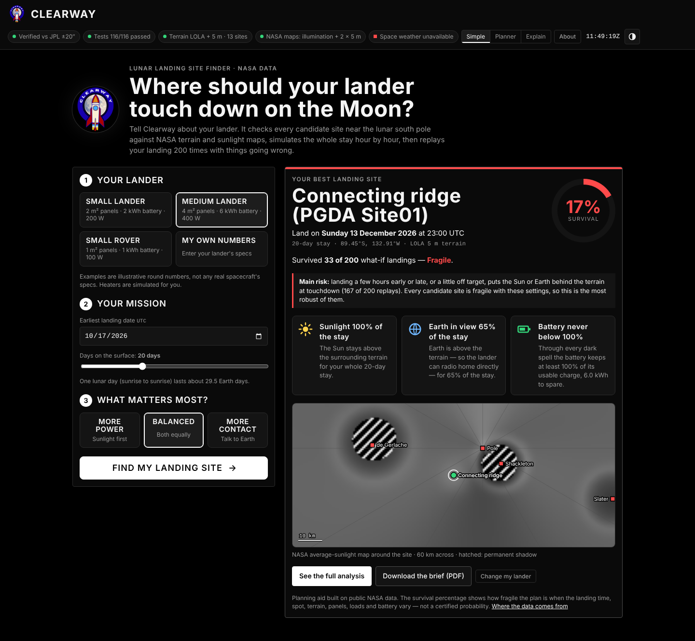
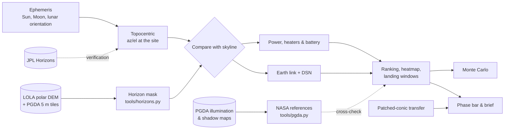

<p align="center"></p>

# Clearway — Lunar Mission Browser

> **Which candidate landing site gives our lander the best chance of surviving its surface mission
> while maintaining contact with Earth?**

Clearway answers that question in seconds for the lunar south pole (and anywhere else on the Moon).
It places the Sun and Earth against each site's real skyline from NASA laser-altimeter maps, then
follows the consequences: sunlight → power → heaters → battery → survival, and Earth above the
terrain → a direct radio link. The answer is a site **and** a landing date, the constraint that limits
it, how often the plan survives when things go wrong, and how much to trust it — including a measured
comparison with NASA's own published illumination maps.

**Clearway 11 (version 6.2)** always opens in **Simple mode**: four questions about your lander (or pick a small lander,
medium lander or rover example), then one answer — the site, the landing date, a survival percentage from
200 what-if landings, three plain reasons and a NASA map. "See the full analysis" opens **Planner** (the full
board) on the same result; **Explain** adds plain-language notes for classrooms. **About** has the founder page
and a register of every data source, where it comes from and how Clearway checks it.

It uses every relevant NASA south-pole product: LOLA elevation maps
(240 m and 40 m/pixel), the PGDA 5 m/pixel site maps (lander-scale slopes and near-field terrain),
and the Mazarico et al. LOLA illumination, Earth-visibility and permanent-shadow maps.

Built for the 2026 NASA Space Apps Challenge **"CLPS Lunar Mission Browser"** by team **DD Engineering**
(Balamurugan Devadarshan), for mission planners, educators and the public.



*Interface preview (rendered with the test dataset; your build shows the NASA data). More: [Planner board](docs/screenshot.png), [horizon view and landing safety](docs/screenshot-horizon.png), [south-pole map](docs/screenshot-map.png), [data sources](docs/screenshot-sources.png).*

### Edit the founder page without coding
Open `web/about/about.md` in Notepad, change the text and save, then refresh the browser. Put a photo named
`photo.jpg` in the same folder to show it. The format is explained at the top of the file.

> Planning aid. It does not replace mission design, navigation or flight dynamics analysis.

---

## Quick start

| Where | Command |
|---|---|
| macOS / Linux | `./run.sh` |
| Windows | double-click `run.bat` |
| Manual | `python server.py --build-terrain --hires` once, then `python server.py --open` |
| Docker | `docker build -t clearway . && docker run -p 8080:8080 clearway` |
| Hosted | Render → **New → Blueprint** → this repo (`render.yaml`) |

Requirements: Python 3.9+ and a current browser. Nothing to install with pip.

The first run downloads the NASA data and builds the terrain (once; later starts are instant):

| Build | Downloads | Adds |
|---|---|---|
| `--build-terrain --quick` | LOLA `ldem_75s_240m` (29 MB) | real skylines for every site |
| `--build-terrain` | + LOLA `ldem_60s_240m` (≈120 MB, terrain north to 60°S, e.g. Chandrayaan-3) + Mazarico et al. average-sunlight, Earth-visibility and permanent-shadow maps (75°S, 120 m/px, ≈350 MB, plus the 240 m maps to 65°S) from the LOLA team's archive (PGDA product 69) | south-pole map, water-ice distances, the NASA cross-check |
| `--build-terrain --hires` (used by `run.bat` / `run.sh`) | + LOLA `ldem_85s_40m` (115 MB) and PGDA 5 m/pixel site maps (product 78: Connecting ridge, Shackleton rim, Nobile rim 1, Peak near Shackleton, de Gerlache rim, Malapert massif) | lander-scale slopes, sharper near-field horizons, six extra candidate sites |
| `--build-terrain --hires --sfs` (optional, large) | + NASA PGDA product 104 shape-from-shading 5 m/pixel terrain of the 13 Artemis III candidate regions (Zenodo; only the elevation file is pulled out of each region's archive) | the newest NASA terrain at those regions; regions without a PGDA 78 site become extra sites |

Add `--tile-extras` to also fetch PGDA's own slope and uncertainty maps for each 5 m site (shown next to
Clearway's slopes). Every product except the 240 m map is optional: if a download fails, the build continues without
it and the app says what is missing. Already have `data/lola/` from an earlier version? Copy that
folder in to skip re-downloading. Without any build the app still works but assumes a smooth Moon,
and says so in the header.

### One-minute tour (or press **Guided tour** in the app)

1. **The verdict** names the recommended site and landing date, whether the battery survives the
   surface stay, the limiting constraint, how the result holds up under stress tests and in the
   Monte Carlo, and whether real terrain was used.
2. **Compare the sites** ranks every candidate on sunlight and Earth-link time, with the best landing
   for the stay. The coloured strip shows which site wins at every mission priority; the presets
   switch between **Power first**, **Balanced** and **Comms first**.
3. **South-pole map · NASA data**: LOLA terrain shading, NASA's 18.6-year average sunlight and the
   permanently shadowed craters (hatched). Click a site to select it or empty ground to add one.
4. **Why this site?** lists strengths and trade-offs against the other sites, the head-to-head with
   the runner-up, and buttons that jump the timeline to the longest night or communications outage.
5. **The horizon view** is the geometry behind every number: the real skyline, the dashed
   smooth-Moon horizon, the Sun and Earth at true size, an optional ±0.5° terrain-uncertainty band,
   and live **SUN UP / LINK AVAILABLE / LINK BLOCKED BY TERRAIN / ON BATTERY** badges. One scrubber
   moves the horizon, sunlight, Earth link, power, heaters, battery and lander temperature together.
   Below it: **landing safety & resources** — slope at the site and across the 100 m landing circle
   (PGDA 5 m maps), distance to the nearest permanently shadowed region (water ice) and NASA's own
   sunlight and Earth-visibility values for the spot.
6. **When to land** colours every landing day: survives the stay, battery runs flat, no safe
   touchdown, or too soon. Sunlit-period and Earth-link-window tables list every interval.
7. **The trade-off explorer** puts two or more sites side by side for one landing time and stay;
   change the stay or the priority and it explains what changed.
8. **Survival under uncertainty** replays each site's planned landing hundreds of times with a late
   landing, a touchdown 100 m off target (real LOLA horizons for those points), terrain error, weaker
   panels, hungrier loads, an aged battery and a steep landing spot, and reports the share of
   scenarios that survive with a 95% interval.
9. **How much to trust this** separates what is modelled, assumed and not modelled, re-runs the
   ranking with a raised and lowered skyline, a stricter link margin, other priorities and a smooth
   Moon, and **cross-checks Clearway against NASA's published illumination maps** — the same
   18.6-year averages recomputed in your browser, with the measured difference for every site.
   **Verification** shows the JPL Horizons check, the 5 m tile checks and the automated test results.
10. **Explain** mode adds plain-language notes for classrooms; the **Landing Director** challenge turns
   the analysis into GO / HOLD / SCRUB calls. **Mission phases** reveals launch, transfer and lunar
   orbit insertion, and the launch planner.

---

## What it does

| Capability | Detail |
|---|---|
| Sun & Earth positions | Analytic ephemeris (Meeus/ELP-2000) + IAU lunar orientation, checked against JPL Horizons to ≈20″ |
| Terrain horizon | Ray-marched from NASA LRO LOLA polar elevation maps and PGDA 5 m/pixel site maps (finest first), 0.5° in azimuth, out to 300 km, with lunar curvature; landmark orientation check; every 5 m tile checked against LOLA |
| Landing safety | Slope at the site and across a 100 m landing circle from the PGDA 5 m maps (with their slope and height uncertainty); regional slope everywhere |
| Water ice | Inside a permanently shadowed region? Distance to the nearest one and the shadowed area within 5 and 20 km (Mazarico et al. map) |
| Thermal | Lumped thermal model: stored heat rides out short shadows, long nights need full heater power; heater energy, peak and temperature reported |
| Monte Carlo | 100–1000 scenarios per site: landing slip, touchdown point (ring horizons 100 m out), skyline error, panel, loads, battery fade, radiator, slope; survival share with Wilson 95% interval; reproducible seed |
| NASA cross-check | 18.6-year average sunlight and Earth visibility recomputed and compared with NASA's published maps at every site |
| Illumination | Sun as a disc (partial shadow); Sun above a smooth horizon vs above the real skyline; longest dark period; every sunlit and dark period |
| Power | Panel area × efficiency × solar flux × visible fraction × incidence; vertical, tracking, fixed or flat panels |
| Battery | State of charge with usable depth, charge/discharge efficiency, operating vs survival loads; minimum charge, battery needed, margin; infeasible stays flagged |
| Direct-to-Earth link | Four tiers kept separate: geometric → terrain line of sight (+ margin) → DSN station in view → operational availability (not modelled) |
| Radio link budget | Link equation with the real Earth–Moon distance each hour: S, X or Ka band, transmitter power and antenna gain, 34 m or 70 m DSN dish → highest data rate and the data volume a stay can return |
| Relay satellite (optional) | One relay on an elliptical frozen orbit whose far point sits over the south pole (illustrative): counted when it is above the site's skyline and can itself see Earth |
| Historical analysis | Pick a past date: Clearway analyses a landing that already happened. **Chandrayaan-3** (About → Chandrayaan-3): ISRO's published timeline beside Clearway's computed sunrise, sunset, night length and Earth link at the Vikram site |
| Decision | Recommended site + landing date for the surface stay, limiting constraint, "why this site", priority presets, winner at every weight |
| Landing calendar | Every landing day: survives / battery flat / no safe touchdown / too soon, with the limiting constraint |
| Trade-off explorer | 2+ sites, same landing and stay, side by side, with "what changed" explanations |
| Trust | Modelled / assumed / not modelled / confidence; stress tests; terrain-vs-smooth comparison; NASA cross-check |
| Verification | JPL Horizons self-check at start-up and live per site; test results from `tools/validation_report.py` |
| Sites | 10 south-pole sites, IM-1, Blue Ghost Mission 1 and Chandrayaan-3, six PGDA 5 m sites (with `--hires`), Artemis III regions from the shape-from-shading maps (with `--sfs`), and any point you click on the map or type in |
| Mission (optional) | Patched-conic TLI, coast, LOI and descent Δv; mission timeline; Earth launch planner as the launch phase |
| Exports | Site & Mission Brief (PDF, 3–4 pages incl. Monte Carlo and NASA cross-check), time series with heater and temperature (CSV), periods (CSV), comparison with Monte Carlo and cross-check (JSON), horizon mask (JSON) |
| Education | Explain mode, guided tour, Landing Director Challenge |
| Devices | Desktop, tablet and phone (controls in a drawer, scrollable charts) |
| Look | Black-and-white interface (space); colour only for status — green go, amber caution, red no-go — always paired with a shape or word |

---

## How it works



**Ephemeris.** The Sun follows Meeus ch. 25 (with annual aberration); the Moon follows Meeus ch. 47,
the truncated ELP-2000/82 theory. Both are precessed to J2000 and rotated into the Moon's Mean Earth
frame with the IAU WGCCRE 2009 model, which includes the physical libration terms. That frame is the
one LOLA maps and Horizons lunar sites use. The ephemeris is site-independent, so it is computed once
per time step and shared by every site: ten sites over 180 days at hourly steps takes about 0.1 s.

**Accuracy.** At start-up and in the test suite, 16 Sun and Earth positions from JPL Horizons (DE441)
at four lunar sites are recomputed; the worst differences are 19″ (Sun) and 10″ (Earth), about
1/200 of a degree. The **Check against JPL Horizons** button repeats the comparison for any site
and date through the server.

**Horizon.** For each of 720 azimuths, `tools/horizons.py` steps outward along the great circle
(finely near the site, then growing 0.4 % per step), samples the LOLA map bilinearly, and keeps the
highest elevation angle seen from 2 m above the ground on a 1737.4 km sphere. It reads the PDS3
label, applies the documented polar-stereographic projection, and confirms the orientation against
known landmarks (Shackleton, Haworth, Mons Mouton and others) before use.

**NASA PGDA products (`tools/pgda.py`, `tools/geotiff.py`).** The 5 m site maps are GeoTIFFs in
south-polar stereographic metres; a dependency-free reader handles their compression and
predictors. Each tile is checked against the LOLA grid (projection convention, height datum,
correlation and RMS) before it is used, and the check is shown in the app. The terrain stack always
uses the finest map covering a point, so the near field comes from the 5 m tile and distant ridges
from LOLA. The illumination products are read through their PDS labels; their scaling is detected
from the data and their orientation confirmed against craters and massifs. For each site the build
stores NASA's value, its spread across ±1 pixel, the permanent-shadow metrics, lander-scale slope
statistics and horizons for six points 100 m away (near field ray-marched from each point, far field
shared — within 0.03° of a full ray-march).

**Illumination and power.** The fraction of the solar disc above the local skyline is a
circular-segment area. Power uses the solar constant scaled by distance. Near the pole the Sun
stays within about 1.5° of the horizon, which is why vertical panels deliver roughly 40 times more
energy than flat ones (shown in the tests).

**Thermal and heaters.** One lumped mass: C dT/dt = absorbed sunlight + electrical load − εσA(T⁴ −
T_sink⁴) + heater. Heaters supply exactly what holds the lander at its minimum temperature; louvres
cap it at the maximum. The default lander cools from 20 °C to −30 °C in about 22 hours of darkness
and then needs about 94 W of heaters on top of 45 W of electronics, so a 10-hour shadow costs
≈0.45 kWh instead of 1.2 kWh, while a 17-day night costs about the same as a fixed 120–140 W load.
Every coefficient is an input.

**Monte Carlo.** Each site's best landing is re-simulated with the uncertain inputs drawn from a
seeded generator; a scenario succeeds if the Sun and Earth are up at touchdown, the ground is within
the tilt limit and the battery never runs flat. The result is the share of scenarios that succeed
with a Wilson 95% interval — a measure of fragility, not a calibrated probability of mission success.

**Cross-check with NASA.** Mazarico et al. (2011) averaged the visible fraction of the solar disc
and the time any part of Earth is visible over an 18.6-year cycle at hourly steps. Clearway
recomputes both quantities over 18.6 years of hourly steps (≈163,000 per site, about two seconds in
a browser) and reports the difference per site and the median over sites. Expected differences
(horizon resolution and extent, the 2 m panel height, pixel versus point, the exact span) are listed
next to the numbers; nothing is assumed to agree.

**Communications.** A direct-to-Earth link needs Earth's centre above the skyline by a margin
(default 0.5°). Earth moves only a few degrees in the sky because of libration, so sites that face
it from a ridge have long links and sites behind terrain may have none. Optionally a DSN complex
must also see the Moon above 10°.

**Transfer.** Coplanar patched conics: an ellipse from the parking orbit that reaches the Moon's
distance after the chosen coast, the arrival excess speed relative to the Moon, capture into a
circular low lunar orbit, and a descent estimate. It reproduces the textbook values of 3.13 km/s
for TLI from 185 km and 0.82 km/s for LOI into a 100 km orbit.

---

## Testing

```bash
npm test
# or
node --test tests/core.test.mjs tests/lunar.test.mjs tests/v4.test.mjs tests/v5.test.mjs tests/v6.test.mjs   # 82 JS tests
python -m unittest discover -s tests                   # 75 Python tests (13 need the real NASA data)
python tools/validation_report.py                      # runs everything, writes web/data/validation.json
```

The lunar suite checks the ephemeris against JPL Horizons and Meeus' worked example, disc geometry,
horizon interpolation, seasonal illumination at the pole, panel geometry, the battery model
(efficiencies, usable depth, load modes, feasibility), periods, the landing calendar, ranking across
weights, explanations, the trade-off explorer, status words and stress tests. The v4 suite tests the
thermal balance (steady heater power, cool-down time, louvres, energy conservation), stay traces, the
Monte Carlo (seeded reproducibility, Wilson intervals, slope and position sampling) and the
cross-check summary. The Python suite tests
the horizon tool against synthetic terrain with known answers (a mesa, a ring wall, a mirrored map),
sites outside the maps, the server and the validation report; the GeoTIFF reader on every supported
layout (strips/tiles, classic/BigTIFF, both byte orders, none/LZW/Deflate/PackBits, both
predictors — the LZW decoder is also cross-checked against libtiff); 5 m tile calibration (it
recovers a mirrored layout and a 400 m datum offset); slopes on a known 12° plane; illumination
scaling and orientation; permanent-shadow metrics; ring horizons against a full ray-march; and the
PNG writer. The v6 suites test the radio link budget against a hand calculation, the relay orbit geometry and Earth occultation, the Chandrayaan-3 timeline on a smooth Moon, one-file extraction from a remote zip (byte ranges, zip64) against a local web server, the shape-from-shading build and the 65°S map fallback. With real LOLA horizons built, extra
tests check that Shackleton's floor is walled in by about 20° walls, Mons Mouton and IM-2 sit about 5 km high, and the landmarks
confirms the map orientation. CI runs everything and publishes the validation report; the app's
**Verification** card and header chip read it.

---

## Sites

Ten south-pole sites: the IM-2 Athena landing site, Mons Mouton, the Malapert Massif region,
Shackleton, de Gerlache, Haworth, Nobile, Slater, Cabeus B and the pole itself. Two flown CLPS landings
away from the pole are included for contrast: **IM-1 Odysseus** (80.13°S, 1.44°E, near Malapert A) and
**Blue Ghost Mission 1** (18.5623°N, 61.8103°E, Mare Crisium; off by default), and ISRO's
**Chandrayaan-3** Vikram landing site (69.3741°S, 32.32°E, LROC image 1314; off by default, used by the
historical analysis). Every site cites a
primary source: named features use the official USGS/IAU Gazetteer of Planetary Nomenclature (feature
number in the app), and landing sites use NASA and the LRO camera team, which located the landers in
orbital images. With `--hires`, six PGDA 5 m sites are added; each is placed on the sunniest point of
its tile where 90% of the ground within 50 m is below 8° (the rule is shown in the app, and these
points are left out of the NASA cross-check summary because they were chosen using NASA's sunlight
map). NASA's Artemis III candidate regions (October 2024) are about 15 km wide and lie near these
features. **Add a site** accepts any latitude; LOLA terrain is computed automatically south of 75°S (60°S once the 60°S map is installed).

## Data sources

| Data | Source |
|---|---|
| Reference ephemeris | [NASA JPL Horizons](https://ssd.jpl.nasa.gov/horizons/) (DE441) |
| Terrain | [NASA LRO LOLA polar gridded data](https://pds-geosciences.wustl.edu/missions/lro/lola.htm), PDS Geosciences Node |
| 5 m site maps | [NASA GSFC PGDA product 78](https://pgda.gsfc.nasa.gov/products/78): High-Resolution LOLA Topography for Lunar South Pole Sites |
| Illumination, Earth visibility, permanent shadow | Mazarico et al. (2011), *Icarus* 211, 1066–1081, listed as [NASA GSFC PGDA product 69](https://pgda.gsfc.nasa.gov/products/69); downloaded from [NASA's PDS Geosciences Node](https://pds-geosciences.wustl.edu/lro/lro-l-lola-3-rdr-v1/lrolol_1xxx/extras/illumination/) (LOLA extras), with the LOLA team archive as backup |
| Shape-from-shading terrain | [NASA GSFC PGDA product 104](https://pgda.gsfc.nasa.gov/products/104), Artemis III regions; Bertone et al., *The Planetary Science Journal*, doi:10.3847/PSJ/ae5b70; files [doi:10.5281/zenodo.17954508](https://doi.org/10.5281/zenodo.17954508) |
| Chandrayaan-3 | Site: [LROC image 1314](https://www.lroc.asu.edu/posts/1314); timeline: [ISRO](https://www.isro.gov.in/Chandrayaan3.html) mission updates (Clearway is not affiliated with ISRO) |
| Lunar orientation | IAU WGCCRE 2009 report (Archinal et al. 2011) |
| Algorithms | J. Meeus, *Astronomical Algorithms*, 2nd ed., ch. 25 and 47 |
| Space weather | [NOAA SWPC](https://www.swpc.noaa.gov) |
| Site coordinates | [USGS/IAU Gazetteer of Planetary Nomenclature](https://planetarynames.wr.usgs.gov/) (named features); NASA and the [LRO camera team](https://lroc.im-ldi.com/) (IM-1, IM-2, Blue Ghost, Malapert) |
| Launch phase | US Space Force catalog via CelesTrak, Open-Meteo, OpenSky, SatNOGS |

## Limitations

- Terrain resolution follows the map used: 5 m/px inside the PGDA tiles, 40 m/px near the pole and
  240 m/px elsewhere. Boulders smaller than a pixel are not modelled; lander-scale slopes exist only
  inside the 5 m tiles (elsewhere only a regional slope).
- The thermal model is one lumped mass with user-set coefficients, not a thermal design.
- The Monte Carlo spreads are user inputs; its result shows fragility, not a calibrated probability.
- Shadows from terrain on the solar panel itself, dust and panel degradation are not modelled.
- The Moon map shading is a smooth sphere: it shows the terminator, not terrain shadows.
- The transfer model is planning grade (no lunar gravity during the coast, no plane changes, no
  free-return design).
- The DSN check uses each complex's position, not antenna schedules; operational link availability
  (pointing, scheduling, weather) is not modelled and is labelled as such. The link budget uses typical
  default values you can change; it ignores atmosphere and elevation-dependent noise. The relay orbit is
  illustrative (two-body, no perturbations, one satellite).
- The Chandrayaan-3 comparison uses Clearway's generic thermal model, not Vikram's design.
- Battery temperature effects and lunar eclipses are not modelled (ageing is sampled in the Monte Carlo).
- Without the LOLA build every site uses a smooth Moon. The app says so (header, site badge,
  confidence LOW) — on a smooth Moon a crater floor such as Shackleton looks sunlit, which real
  terrain contradicts. Build the terrain before judging results.

## Project layout

```
server.py                 stdlib server: app, Horizons proxy, terrain horizons, launch-phase proxies
tools/horizons.py         LOLA reader + horizon ray-marcher + build (CLI and library)
tools/pgda.py             NASA PGDA products: downloads, 5 m tiles, slopes, illumination, shadow, polar map
tools/geotiff.py          dependency-free GeoTIFF reader
tools/validation_report.py runs every check, writes web/data/validation.json
web/index.html            Lunar Mission Browser
web/js/lunar/             ephemeris, horizon, analysis, thermal, montecarlo, crosscheck, polarmap,
                          transfer, charts, brief, sites, reference, tour
web/js/lunar-main.js      app wiring
web/launch.html, js/      launch phase (Clearway Earth launch planner)
web/data/horizons.json    built terrain horizons, slopes, NASA references (after --build-terrain)
web/data/polar-*.png      south-pole map layers (after --build-terrain)
data/                     downloaded NASA products (lola/, pgda/)
firmware/                 micro:bit flight logger and ground station
tests/                    Node and Python test suites
docs/                     architecture, demo script
```

## Use of AI

The idea, data choices, design decisions, testing against real NASA data and the Chandrayaan-3 analysis are
by Balamurugan Devadarshan. AI assistance (Claude, by Anthropic) was used to help write and debug the code.
No AI-generated images, video or audio are included in this repository. The screenshots in `docs/` are
captures of the running app.

## Fonts, libraries and other resources

- Fonts: IBM Plex Sans, IBM Plex Mono and Barlow Condensed (SIL Open Font License, Google Fonts), used in the app
  and the demo deck, with system fonts as fallback.
- Libraries: [satellite.js](https://github.com/shashwatak/satellite-js) 4.1.4 (MIT) for SGP4 propagation and
  [world-atlas](https://github.com/topojson/world-atlas) 2.0.2 (ISC, Natural Earth data) for the Earth map, downloaded
  to `web/vendor/` on first run and not stored in this repository.
- No NASA or ISRO logos or mission insignia are used. Clearway is not affiliated with NASA or ISRO.

MIT licence. See [LICENSE](LICENSE) and [CONTRIBUTING.md](CONTRIBUTING.md).
