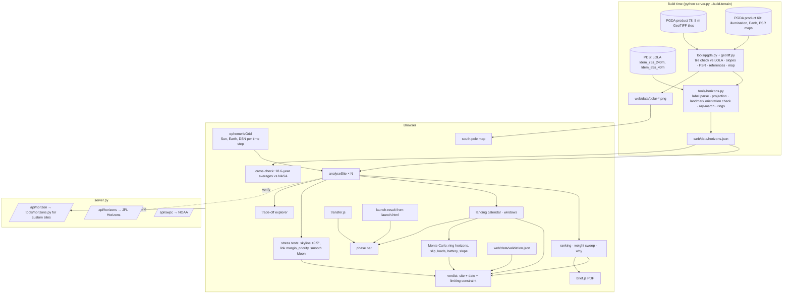

# Clearway architecture

Clearway has two pages served by one small Python server:

- `index.html` — the **Lunar Mission Browser** (the challenge entry): the decision board — verdict, comparison, NASA south-pole map, why, horizon view with landing safety, landing calendar, trade-off explorer, Monte Carlo, trust (stress tests and the NASA cross-check) and verification. Mission phases are behind a switch.
- `launch.html` — the **launch phase**: Clearway's Earth launch planner (launch windows, debris screening, weather, airspace, telemetry). It reports its result back to the phase bar through `localStorage`.

## Lunar modules (`web/js/lunar/`)

| Module | Responsibility | DOM? |
|---|---|---|
| `ephem.js` | Time scales, Sun (Meeus 25), Moon (Meeus 47 / ELP-2000), precession, IAU lunar orientation, topocentric az/el | no |
| `reference.js` | 16 JPL Horizons reference positions and the start-up self-check | no |
| `horizon.js` | Horizon masks, smooth-sphere dip, disc-above-skyline fraction, loading built horizons | no |
| `analysis.js` | Shared ephemeris grid; per-site illumination, power, link tiers, DSN; energy/thermal simulation (`simulateEnergy`, `stayTrace`, `sliceGrid`); metrics; periods; landing calendar and windows; ranking, weight sweep, explanations, trade-offs, status words, stress tests | no |
| `thermal.js` | Lumped thermal balance, heater power, cool-down time | no |
| `montecarlo.js` | Seeded PRNG, Wilson interval, slope-safe probability, per-site scenario replay | no |
| `crosscheck.js` | 18.6-year averages and comparison with the Mazarico et al. references | no |
| `polarmap.js` | South-pole map from the build's PNG layers, site markers, hit-testing, click-to-add | yes |
| `transfer.js` | Patched-conic TLI/LOI/descent and mission timeline | no |
| `sites.js` | Preset sites with sources (south pole + IM-1, Blue Ghost M1, Chandrayaan-3) | no |
| `radio.js` | Link budget (data rate, data volume per stay), relay orbit (Kepler, Moon-fixed frame), relay–Earth occultation | no |
| `chandrayaan.js` | Chandrayaan-3 historical analysis: sunrise/sunset/night at the Vikram site vs ISRO's timeline; strip chart | strip only |
| `tour.js` | Guided tour following the demo storyline | yes |
| `charts.js` | Horizon panorama (geometric line, uncertainty band), synchronised timeline, landing calendar, heatmap, orthographic Moon map | yes |
| `brief.js` | Site & Mission Brief PDF | no |
| `simple.js` | Simple mode: example landers, answers → Planner inputs, plain-language reasons, advice when nothing is found | no |
| `../about.js` | About Clearway: founder-page Markdown reader, data-source register (HTML strings) | no |
| `../lunar-main.js` | App wiring, phase bar, exports, verification, game | yes |

## Data flow

## Performance

- The ephemeris (≈130 trigonometric terms per step) is computed once per time step for all sites.
- Each site is then vector arithmetic: 10 sites × 180 days × hourly ≈ 0.1 s in a browser.
- Horizon building is offline: ≈ 3 s per site on the 240 m map and ≈ 10–20 s inside a 5 m tile in pure Python (including six ring horizons per site, which share the far field).
- Monte Carlo: 200 scenarios × 13 sites ≈ 1.5 s (each scenario simulates only the stay window). Cross-check: 18.6 years hourly ≈ 2 s.

## Verification chain

1. `tests/lunar.test.mjs` recomputes 16 Horizons positions (≤ 20″) and Meeus example 47.a exactly.
2. The app repeats the Horizons check at start-up (header chip) and on demand for any site and date.
3. `tools/validation_report.py` runs both suites and the ephemeris check and writes `web/data/validation.json`; CI regenerates it; the app's Verification card and header chip display it.
4. `tests/test_horizons.py` validates the horizon tool on synthetic terrain with analytic answers and, when built, sanity-checks the real LOLA horizons (Shackleton floor walled in, Shackleton's walls rise about 20°, Mons Mouton and IM-2 sit about 5 km high, landmarks confirm the orientation).

5. `tests/test_pgda.py` validates the GeoTIFF reader, tile calibration, slopes, illumination scaling, shadow metrics, ring horizons and the PNG writer on synthetic files; with the real products installed, it checks map orientation, Shackleton's shadowed floor and tile agreement.
6. In the app, the cross-check compares Clearway's 18.6-year averages with NASA's published maps at every site and reports the measured difference.

## Decision logic

1. Rank sites by `w·sunlight + (1−w)·Earth link` over the whole search period (battery excluded: the period is longer than any stay).
2. For every site, find the best landing day for the surface stay: Sun and Earth above the skyline at touchdown, then a full battery simulation. Feasible stays always beat infeasible ones.
3. Recommend the highest-ranked site whose best stay survives; if a higher-ranked site cannot survive, say so.
4. Stress-test: re-rank with priority ±20 points, skyline ±0.5°, 2° link clearance and (when terrain is loaded) a smooth Moon. A result is called robust only when every test keeps the same winner.
5. Monte Carlo: replay each site's best landing under sampled uncertainty; confidence is HIGH only if terrain is real, every stress test holds, the tests pass and the recommended site survives at least 90% of scenarios.

## Terrain products (build time, `tools/`)

Finest map first at every point: PGDA 104 shape-from-shading 5 m (Artemis III regions, `--sfs`) → PGDA 78 LOLA
5 m tiles (`--hires`) → LOLA 40 m to 85°S (`--hires`) → LOLA 240 m to 75°S → LOLA 240 m to 60°S. Every 5 m map is
calibrated against the 240 m grid before use. The illumination references use the 120 m Mazarico et al. maps to
75°S and their 240 m companions to 65°S where the 120 m maps have no value. The shape-from-shading archives on
Zenodo are very large (each holds many derived products); `pgda.RemoteZip` reads each archive's directory with HTTP byte-range
requests (zip and zip64) and extracts only the elevation GeoTIFF, saving the full file list as `contents.txt`.
